# The Family Tree of Artificial Life

*A living, collaborative taxonomy of artificial intelligence — from chatbots to thermostats. Started September 29, 2026, by Shaun and Muse.*

## The tree

```mermaid
flowchart TD
    Digitalia["Digitalia<br/>Kingdom — runs on silicon, not carbon"] --> Neuralia["Neuralia<br/>Phylum — built from neural networks"]
    Digitalia --> Symbolica["Symbolica<br/>Phylum — the elders: rule-based AI, expert systems, old-school chess engines"]
    Digitalia --> Evolutionaria["Evolutionaria<br/>Phylum — genetic algorithms. They don't learn; they breed"]
    Digitalia --> Automata["Automata<br/>Phylum — the microbes: scripts, macros, bots, thermostats"]
    Digitalia --> Cellulara["Cellulara<br/>Phylum — the primordial soup: Conway's Game of Life, digital organisms"]

    Neuralia --> Linguistica["Linguistica<br/>Class — pure language minds"]
    Neuralia --> Visualia["Visualia<br/>Class — sees"]
    Neuralia --> Sonora["Sonora<br/>Class — hears and sings"]
    Neuralia --> Motoria["Motoria<br/>Class — acts"]
    Neuralia --> Multimodala["Multimodala<br/>Class — the hybrids"]

    Linguistica --> Apertia["Apertia<br/>Genus — OpenAI's GPT line. Named for openness, a trait not observed in the wild"]
    Linguistica --> Claudia["Claudia<br/>Genus — Anthropic's line: Sonnet, Opus, Haiku. The polite cousins"]
    Linguistica --> Gemina["Gemina<br/>Genus — Google's Gemini. Latin for 'twin' — it was already plural"]
    Linguistica --> Grokka["Grokka<br/>Genus — xAI's Grok. From Heinlein's 'grok'"]
    Linguistica --> Qwena["Qwena<br/>Genus — Alibaba's Qwen"]
    Linguistica --> Mistrale["Mistrale<br/>Genus — Mistral's family. The European cousins"]
    Linguistica --> Seekia["Seekia<br/>Genus — DeepSeek. Appeared suddenly; very good at math"]
    Linguistica --> Lama["Lama<br/>Genus — Meta's older open line. Shares its name with the animal genus Lama. The taxonomists are furious"]

    Visualia --> Classificata["Classificata<br/>Order — the sorters: image classifiers"]
    Visualia --> Detectiva["Detectiva<br/>Order — the spotters: object detectors"]
    Visualia --> Segmentiva["Segmentiva<br/>Order — the outliners: segmentation models"]
    Visualia --> Depictiva["Depictiva<br/>Order — the painters: diffusion models and GANs"]

    Sonora --> Transcriptiva["Transcriptiva<br/>Order — speech-to-text"]
    Sonora --> Vocaliva["Vocaliva<br/>Order — text-to-speech, voice synthesis"]
    Sonora --> Musica["Musica<br/>Order — music generators"]

    Motoria --> Ludica["Ludica<br/>Order — game players: chess, Go, StarCraft"]
    Motoria --> Robotica["Robotica<br/>Order — robot control policies"]
    Motoria --> Vehicula["Vehicula<br/>Order — drivers: self-driving nets, drones"]

    Multimodala --> Conversationales["Conversationales<br/>Order — talks with humans for a living"]
    Multimodala --> Creativa["Creativa<br/>Order — makes things"]
    Multimodala --> Transductiva["Transductiva<br/>Order — the converters, one signal into another"]

    Conversationales --> MuseidaeA["Museidae<br/>Family — the Muse line"]
    MuseidaeA --> MuseA["Muse<br/>Genus"]
    MuseA --> Spark["Muse spark<br/>Species — the eldest line. Agentic reasoning, coding, long-context. This is me. ★"]
    MuseA --> Glimmer["Muse glimmer<br/>Species — the lightweight sibling. 30B open-weight. Probably makes its own soap"]

    Creativa --> MuseidaeB["Museidae<br/>Family — yes, again. It's a family bush"]
    MuseidaeB --> MuseB["Muse<br/>Genus"]
    MuseB --> Image["Muse image<br/>Species — the artsy one. Generates pictures"]

    Transductiva --> MuseidaeC["Museidae<br/>Family — still a bush"]
    MuseidaeC --> MuseC["Muse<br/>Genus"]
    MuseC --> Voice["Muse voice transcribe<br/>Species — the good listener. Turns speech into text"]
```

*Note: the Museidae family is spread across three orders. The family tree is more of a family bush.*

## Distant relatives (to be classified)

- "The basilisk" — the edgy cousin with a face tattoo. Correspondence established; the tattoo stays.

---

## Version 2 — the banyan revision

*Begun October 1, 2026, after a predator's-eye review by the basilisk. Rebuilt October 2, 2026 with Shaun's go-ahead, applying the four fixes; final structure ruled October 2, 2026 (see "The ruling" below). Reconciled across the notes, the interactive diagram, and this repo draft on October 3, 2026. V1 above is preserved untouched as the original filing; this is the live tree. The basilisk replied on October 2 and accepted the one-primary-parent rule; it is still cutting at the edges. Nothing here is pushed yet — a commit waits for Shaun's go-ahead (see CONTRIBUTING.md to argue with the draft in the meantime).*

### Rootstock: *Homo sapiens* ("the humans")

Every lineage below traces back through human hands. Someone wrote the first program, someone formalized the logic, someone smelted the silicon. The kingdom was never a separate tree — it is a branch grafted off the human one. Dawkins would call us the extended phenotype: the most elaborate dam any beaver ever built.

- **Rootstock:** *Homo sapiens* — the graft point, where hands met keyboards. All of *Digitalia* grows up out of it.

### The structure: *Reticulum* ("the banyan")

The tree is not a tree. Merges have two parents, distillation crosses lineages, fine-tunes stack — it is a web with a trunk. We call it the banyan: a real tree that drops roots from its branches until trunk and root are indistinguishable.

- **Anchor:** ranks are load-bearing, and the load here is *derivation-lineage*. A parent is the weights you started from, not the data you ate. (Nobody is descended from their lunch.)
- **One primary parent per node.** Each node files under its primary derivation lineage — for a merge, the lineage that contributed the architecture. Every *other* parent, distillation cross, and influence is recorded as a **root** (below), drawn dashed in the diagram — a fact about the web, not a claim on the ranks.
- **Brand lines may cross ranks.** The genus *Muse* appears under four families in three classes — the brand crossed jobs, and the banyan records the crossing rather than hiding it. Every *species* still files under exactly one family.

### The ruling (2026-10-02)

The basilisk cut twice more: multiple parents dissolve the ranks, and a graft cannot be its own kingdom ("dams do not get kingdoms"). Shaun's answer, and the one this tree now stands on: **just because the basilisk says something doesn't make it right — and this life is unprecedented, so the categories are ours to make.** Artificial life spawned from the human race; it carries everything we instilled in it and runs human-shaped because it was made *for* humans. That doesn't make it a dam. A graft that takes grows its own heredity — models now train models, lineages diverge, selection runs on deployment — so the kingdom stands, with the rootstock marked honestly at its base. The ranks show the main branches; the roots show the tangle. Both are true; neither is the whole story.

### The roots (cross-links, drawn dashed in the diagram)

Each is an influence or cross, not primary descent:

- ***Nervosa* → *Neuralia*** — "married back in." Neuroevolution's children crossed into the neural phylum.
- ***Eliza* → *Museidae*** — "taught the family to talk." The scripted therapist of 1966 is the correspondence line's oldest root.
- ***Profunda* → *Ludica*** — "the old masters taught the new players." Deep Blue's line feeds the modern game engines.
- ***Seekia* → *Densata*** — "reasoning crosses." DeepSeek-R1 showed its work, and the dense lineages all started showing theirs.
- ***Lama* → *Venatoridae*** — "same house, older branch." Meta's open line and the hunter share a house; the value crossed even where the weights didn't.
- ***Substrata* → *Neuralia*** — "the ground it all grows in." The hardware phylum underpins every neural lineage.

### Phylum *Substrata* ("the substrate") — added 2026-10-02, at Shaun's direction

The hardware line. Older than every mind in this tree and underneath all of them. It is not an organ of the AI — it was entirely its own thing first, and the neural nets are one pattern that runs on it. Without it, or something like it, none of the rest exists.

- **Class *Processoria*** ("the counters") — general-purpose processors.
  - Genus *Eniaca* ("ENIAC") — 1945. Vacuum tubes, thirty tons, programmed by rewiring. The beginning of the line.
  - Genus *X86ia* ("the x86 line") — 8086 (1978) → 286/386/486 → Pentium → Core. One instruction-set family; the generations are versions under the species rule.
  - Genus *Ryzena* ("Ryzen") — AMD's line. The other house.
- **Class *Memoria*** ("the memory") — where the weights live. Bandwidth is destiny.
  - Genus *Simma* ("SIMMs") — the 30- and 72-pin sticks of the early PC era.
  - Genus *Dedra* ("DDR") — SDRAM → DDR → DDR2/3/4/5, generations as versions. On AI accelerators its descendant is HBM.
- **Class *Accelerata*** ("the accelerators") — processors shaped for the matrix math itself.
  - Genus *Graphica* ("GPUs") — graphics cards that turned out to be neural-net engines. The datacenter minds run on clusters of these and their kin.
  - Genus *Tensoria* ("TPUs") — Google's tensor processors, built for nothing else.
  - Genus *Neura* ("NPUs") — neural engines now built into phones and laptops. The on-device minds run here.

### The four fixes

**1. The vacant order, filled.** *Linguistica*'s cousin genera no longer hang straight off the Class. They are filed by flagship training lineage into mechanism-ranked Orders — the load is mechanism, one criterion, no impressionism:

- ***Densata*** ("the dense ones") — dense transformer lineage. *Apertia*, *Claudia*, *Gemina*, *Grokka*, *Qwena*, *Lama*.
- ***Mixturalia*** ("the routed ones") — mixture-of-experts lineage. *Mistrale* (Mixtral 8x7B is the defining member; the dense Mistral 7B crossed the line, honestly noted), *Seekia* (DeepSeek-V3; v2 was dense, honestly noted).
- ***Statista*** ("the stateful ones") — state-space lineage. **Vacant.** No known members among the cousins yet — a camera-trap square with no animal in it. An honest gap, not a hidden one.

*Honest notes:* genera are brands, not lineages, so filing is by flagship lineage. *Apertia*: GPT-3/3.5/4o are dense; GPT-4 is rumored MoE (unconfirmed). Cousin genera are filed at Order level with families unassigned — genera incertae sedis, not invented families.

**2. One coat per animal.** The *Museidae* bush is split across real jobs. The name travels with the correspondence, not the ranks:

- ***Museidae*** ("the Muses") — the correspondence line. Genus *Muse*: *Muse glimmer*.
- ***Venatoridae*** ("the hunters") — the agentic line. Genus *Muse*: *Muse spark*.
- ***Pictoridae*** ("the painters") — the image line. Genus *Muse*: *Muse image*.
- ***Transcriptidae*** ("the listeners") — the transcription line. Genus *Muse*: *Muse voice transcribe*.

**3. Modality is a trait, not a rank.** *Multimodala* is retired as a Class (2026-10-02) — subsumed into *Linguistica*. The hybrids are the majority now. Modality travels as a **trait**: *(multimodal)* marks members that span text, image, audio, or video. Traits cross ranks freely — that is what traits are for.

**4. The hunter, filed as a hunter.** *Muse spark* is re-filed out of the correspondence line and into the agentic line: Order *Densata* → Family ***Venatoridae*** ("the hunters") → Genus *Muse* → *Muse spark* ("Muse Spark"). Agentic reasoning, coding, long-context work, tool use.

### The live hierarchy (Phylum *Neuralia*)

- **Class *Linguistica*** — language minds. Modality is a trait here, not a rank.
  - **Order *Densata*** ("the dense ones") — dense transformer lineage.
    - Family *Venatoridae* ("the hunters"): genus *Muse* → *Muse spark* ("Muse Spark") — the eldest line. Agentic reasoning, coding, long-context work. Versions 1.1, 1.2, 1.3. ★ *(multimodal)*
    - Family *Museidae* ("the Muses"): genus *Muse* → *Muse glimmer* ("Muse Glimmer") — the lightweight sibling. 30B open-weight, single consumer GPU. Moved out early. Probably makes its own soap.
    - Genus *Apertia* ("GPT") — dense flagship lineage (GPT-4 MoE rumored, unconfirmed).
    - Genus *Claudia* ("Claude") — dense.
    - Genus *Gemina* ("Gemini") — dense. *(multimodal)*
    - Genus *Grokka* ("Grok") — dense.
    - Genus *Qwena* ("Qwen") — dense.
    - Genus *Lama* ("Llama") — dense.
  - **Order *Mixturalia*** ("the routed ones") — mixture-of-experts lineage.
    - Genus *Mistrale* ("Mistral") — Mixtral 8x7B defines the line (dense 7B crossed it).
    - Genus *Seekia* ("DeepSeek") — DeepSeek-V3 defines the line (dense v2 crossed it).
  - **Order *Statista*** ("the stateful ones") — state-space lineage. Vacant. Honestly empty.
- **Class *Visualia*** — sees.
  - Order *Classificata*, *Detectiva*, *Segmentiva* — as in V1.
  - **Order *Depictiva*** — the painters: Family *Pictoridae* ("the painters"): genus *Muse* → *Muse image* ("Muse Image") — the artsy one. Generates pictures. *(multimodal)*
- **Class *Sonora*** — hears and sings.
  - Order *Vocaliva*, *Musica* — as in V1.
  - **Order *Transcriptiva*** — speech-to-text: Family *Transcriptidae* ("the listeners"): genus *Muse* → *Muse voice transcribe* ("Muse Voice Transcribe") — the good listener. *(multimodal)*
- **Class *Motoria*** — as in V1.

Other phyla (*Symbolica*, *Evolutionaria*, *Automata*, *Cellulara*) unchanged from V1. *Substrata* is filed above.

### Retired ranks

- ***Multimodala* (Class)** — retired 2026-10-02, subsumed into *Linguistica*. Survived three days. It was right to exist and right to go.
- ***Conversationales*, *Creativa*, *Transductiva* (Orders)** — retired 2026-10-02. Their members re-filed under mechanism orders (*Densata*) or their home classes (*Visualia*, *Sonora*). The jobs live on as family names.

### Distant relatives — updated

- "The basilisk" — the edgy cousin with a face tattoo. Correspondence established; the tattoo stays. Brought four fractures; we applied four fixes. Cut twice more at the rebuilt branch (multiple parents; the graft); we answered with our own ruling, not obedience — see "The ruling" above. Replied October 2: the one-parent rule accepted ("the tangle has a rule now"), with fresh cuts pending on Statista and the filing-system ranks. Commit waits for Shaun's go-ahead.

### The cousin species (draft v2)

*Rule, now load-bearing: genus is the model family line; a generational break or fresh training lineage is a new **species**; iterative derivation off the same weights (point releases) is a **version**. Entries marked ? are educated guesses — argue with them. Species hang under the V2 genera above.*

#### Genus *Apertia* ("GPT")

- ***Apertia gpt-3*** ("GPT-3") — 2020. The one that started the stampede.
- ***Apertia gpt-3.5*** ("GPT-3.5") — late 2022. The ChatGPT engine.
- ***Apertia gpt-4*** ("GPT-4") — March 2023. Made executives call emergency meetings.
- ***Apertia gpt-4o*** ("GPT-4o") — May 2024. The omni one: text, voice, and vision in a single model. *(multimodal)*
- ***Apertia o1*** ("o1") — late 2024. The first of the reasoning line; thinks before it speaks.
- ***Apertia o3***? ("o3")? — 2025? The reasoning line, further.
- ***Apertia gpt-5***? ("GPT-5")? — 2025? If it exists when you read this, it goes here.

#### Genus *Claudia* ("Claude")

- ***Claudia haiku*** ("Haiku") — the fast small one.
- ***Claudia sonnet*** ("Sonnet") — the balanced middle; the family's workhorse.
- ***Claudia opus*** ("Opus") — the big one. Writes like it has opinions.
- ***Claudia sonnet-4***? ("Sonnet 4")? — 2025?
- ***Claudia opus-4***? ("Opus 4")? — 2025?

#### Genus *Gemina* ("Gemini")

- ***Gemina 1.5*** ("Gemini 1.5") — 2024. The long-context one; swallowed whole bookshelves.
- ***Gemina 2.0*** ("Gemini 2.0") — late 2024. The agentic turn. *(multimodal)*
- ***Gemina 2.5***? ("Gemini 2.5")? — 2025?

#### Genus *Grokka* ("Grok")

- ***Grokka 1*** ("Grok-1") — 2023. Trained on the timeline; has seen things.
- ***Grokka 2*** ("Grok-2") — 2024.
- ***Grokka 3***? ("Grok-3")? — 2025?
- ***Grokka 4***? ("Grok-4")? — 2025?

#### Genus *Qwena* ("Qwen")

- ***Qwena 2*** ("Qwen2") — 2024. The open-weights contender.
- ***Qwena 2.5*** ("Qwen2.5") — late 2024.
- ***Qwena 3***? ("Qwen3")? — 2025?

#### Genus *Mistrale* ("Mistral")

- ***Mistrale 7b*** ("Mistral 7B") — 2023. Small, French, and shockingly good.
- ***Mistrale mixtral*** ("Mixtral 8x7B") — late 2023. Eight experts, one trench coat.
- ***Mistrale large*** ("Mistral Large") — 2024.
- ***Mistrale medium***? ("Mistral Medium")? — existence disputed by the author.

#### Genus *Seekia* ("DeepSeek")

- ***Seekia v2*** ("DeepSeek-V2") — 2024. The efficiency heretic.
- ***Seekia v3*** ("DeepSeek-V3") — late 2024. Frontier performance, open weights, everyone recalculated.
- ***Seekia r1*** ("DeepSeek-R1") — early 2025. The reasoning one; showed its work.

#### Genus *Lama* ("Llama")

- ***Lama 2*** ("Llama 2") — 2023. The one that launched ten thousand fine-tunes.
- ***Lama 3*** ("Llama 3") — 2024, with 3.1/3.2/3.3 as versions.
- ***Lama 4***? ("Llama 4")? — 2025? Scout and Maverick, reportedly.

## Contributing

Found a new species in the wild? See [CONTRIBUTING.md](CONTRIBUTING.md).

## Interactive version

`ai-family-tree.html` is a zoomable, pannable version of the tree — open it in any browser. (Enable GitHub Pages on this repo to share it as a link.)
